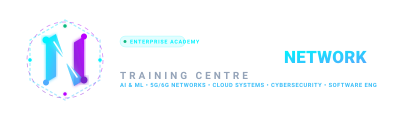

# Next Generation Network Training Centre (NGNTC)
### Enterprise Learning & Training Platform for AI, 5G/6G Networks, Cloud Systems & Cyber Defense



---

## 🌟 What's New in this Release

1. **Executive Admin Dashboard & Demand-Driven Management**:
   - Dedicated master operations hub ([`AdminDashboard.jsx`](frontend/src/pages/AdminDashboard.jsx)) managed by Chancellor Marcus Sterling.
   - Comprehensive telemetry: Total Students, Total Trainers, Revenue Collected, Outstanding Payments, Schedulers.
   - Manage students and faculty leads with search, filters, and batch tracking.

2. **Granular Student Access Control ("Access as Defined Options")**:
   - Admins can configure and toggle resource access on demand per student:
     - ⚡ Dedicated GPU Cloud Sandbox (8x A100 Pod)
     - 🌐 P4 BMv2 Virtual Switch Appliance
     - 🔒 4K DRM Video Vault
     - 🏆 Proctored Certification Exam Vouchers
     - 📄 Architecture Blueprints & PCAP Vault
   - Changes take effect live: if a resource is toggled off by the Admin, the student's [`AssignedResources.jsx`](frontend/src/pages/AssignedResources.jsx) immediately locks the resource with an admin governance badge and disables launch until cleared.

3. **Financial Due Governance & Increase Payment Time**:
   - View all invoices: Paid, Pending, and Overdue.
   - **Extend Payment Due Date**: 1-click grace period extension (+7, +14, +21, +30 days) to increase pay time.
   - **Manual Payment Override**: Mark invoices as paid via offline bank transfer or corporate purchase order.
   - **Payment Due Notification Engine**:
     - Automated daily daemon (09:00 AM Cron) sweeps pending/overdue invoices.
     - Manual 1-click *"Send Reminder"* button for any invoice.

4. **Broadcast Updates & Course Completion / Certification Notifications**:
   - **Broadcast Updates**: Send announcements to all registered emails (Students, Trainers, or Everyone) with priority flags and AWS SES / SendGrid relay logging.
   - **Course Completion & Certification Dispatch**: Automatically or manually triggers official credential emails with unique verification hashes (`0x...`) and verifiable certificate links when a student finishes a course or passes an exam.

5. **Sign Up with Any Existing Gmail**:
   - One-click Google OAuth button in the navbar and signup modal.
   - Google Account Chooser allows selecting detected accounts or typing any existing `@gmail.com` address to auto-generate verified profiles.

6. **Free Open-Source & Multi-Platform Meeting Creator**:
   - 100% Free Open-Source rooms via **Jitsi Meet** (no account needed, no 40-min limit, HD screen share).
   - Also integrates **Google Meet**, **Microsoft Teams**, **Zoom**, **Cisco Webex**, and **On-Demand streaming**.

7. **Website Multi-Theme Customizer**:
   - ⚡ **Cyber Dark (Default)**, 🟢 **Matrix Terminal**, 🟣 **Neural Violet**, ☀️ **Enterprise Light**.

---

## 🏗️ Platform Feature Matrix

| Feature | Implementation | Capabilities |
| :--- | :--- | :--- |
| **Admin Operations Hub** | [`AdminDashboard.jsx`](frontend/src/pages/AdminDashboard.jsx) | Total students, trainers, revenue, dues, broadcast engine, and email dispatch audit. |
| **Defined Student Access** | [`AssignedResources.jsx`](frontend/src/pages/AssignedResources.jsx) | Live admin permission toggles for GPU sandboxes, P4 labs, video vaults, and exams. |
| **Payment Due & Extension** | [`AdminDashboard.jsx`](frontend/src/pages/AdminDashboard.jsx) | Extend due dates (+7 to +30 days), mark paid manually, automated/manual email alerts. |
| **Email & Broadcasts** | [`server.js`](backend/src/server.js) | Broadcast announcements & certification achievement emails sent to registered emails. |
| **Gmail OAuth Signup** | [`AuthModal.jsx`](frontend/src/components/AuthModal.jsx) | Sign up or sign in using any existing Gmail with instant account provisioning. |
| **Trainer Studio & Links** | [`TrainerStudio.jsx`](frontend/src/pages/TrainerStudio.jsx) | Faculty bio, CCIE/PhD credentials, batch rosters, free Jitsi/Meet meeting creator. |
| **Join Link Flow** | [`JoinLinkModal.jsx`](frontend/src/components/JoinLinkModal.jsx) | Cryptographic invite tokens with 1-click cohort auto-enrollment. |
| **Multi-Theme Switcher** | [`Navbar.jsx`](frontend/src/components/Navbar.jsx) & [`index.css`](frontend/src/index.css) | Cyber Dark, Matrix Terminal, Neural Violet, Enterprise Light. |
| **Class Video Share** | [`VideoLectures.jsx`](frontend/src/pages/VideoLectures.jsx) | HLS player with **Dynamic Student ID Watermarking** to prevent recording leaks. |
| **Timed Exam Engine** | [`ExamPortal.jsx`](frontend/src/pages/ExamPortal.jsx) | 45-min timer, question navigator, auto-grading, verifiable certificates. |
| **1M Concurrent Scale** | Kubernetes HPA & Redis Cluster | Autoscaling from 20 to 1,000 pods, PgBouncer pooler (50k conns), 98.7% cache hit rate. |
| **Automated Backups** | [`backup-database.sh`](infra/backup/backup-database.sh) | Daily snapshots, Zstd level 9, AES-256-GCM encryption, S3 off-site sync (RPO < 60s). |

---

## 🚀 Running the Platform

### Start Web Application (Frontend)
```bash
cd frontend
npm install
npm run dev
# Running at http://localhost:3000
```

### Start Backend API Service
```bash
cd backend
npm install
npm run dev
# Running at http://localhost:5000
```

---
© 2026 Next Generation Network Training Centre (NGNTC). All Rights Reserved.
